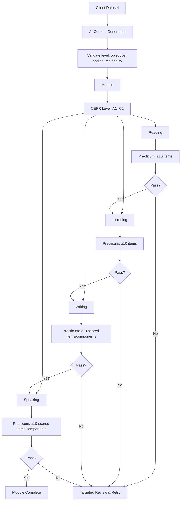
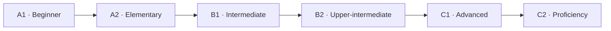
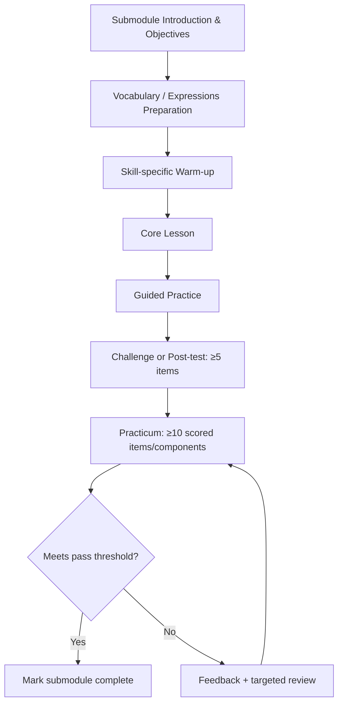
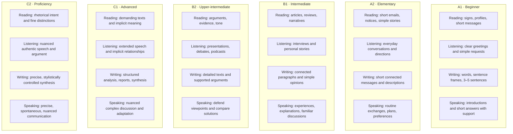
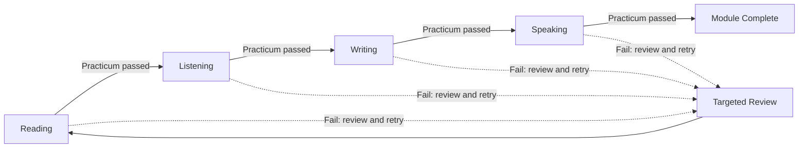
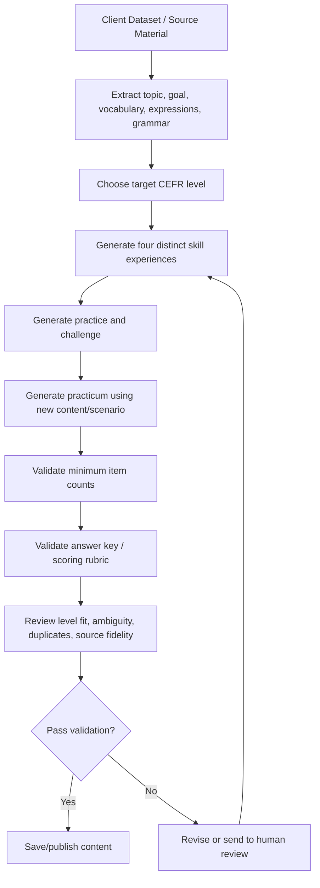
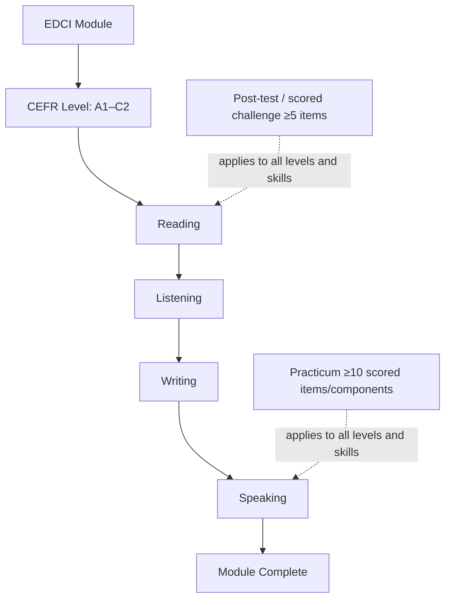

# EDCI Module Framework — CEFR A1–C2
**Version:** 1.1 — Mermaid edition  
**Status:** Draft proposal for client-guided AI content generation  
**Date:** 11 October 2026

> **Purpose:** Use this framework as a curriculum and content-generation guide. The client's dataset remains the source material; the AI should transform it into skill-specific activities while respecting the target level, assessment rules, and progression logic.
>
> **Important:** This is a proposed EDCI framework aligned broadly with CEFR. It is not a claim that EDCI has officially published or adopted this exact syllabus.

## 1. Framework overview



## 2. CEFR level order



| Order | Level | Broad target |
|---:|---|---|
| 1 | A1 | Familiar expressions and very simple phrases; basic personal needs |
| 2 | A2 | Routine exchanges and simple descriptions of familiar situations |
| 3 | B1 | Main points on familiar topics; connected language and simple reasons |
| 4 | B2 | Detailed arguments, viewpoints, and more fluent independent communication |
| 5 | C1 | Demanding texts, implicit meaning, and flexible academic/professional communication |
| 6 | C2 | Precise, nuanced communication and synthesis of complex material |

These are broad targets. A single lesson or module should not be treated as proof of formal CEFR certification.

## 3. Universal submodule flow



Vocabulary is shared support for all skills. It must not replace the distinct learning objective of Reading, Listening, Writing, or Speaking.

## 4. Skill-specific activity templates

### Reading
1. Introduction and learning objectives
2. Vocabulary preparation
3. Warm-up / activate topic knowledge
4. Reading lesson using a level-appropriate text
5. Comprehension practice
6. Reading challenge or post-test
7. Reading practicum

### Listening
1. Introduction and learning objectives
2. Vocabulary and expressions needed for the audio
3. Pre-listening prediction
4. Listening lesson: first listen for gist, then for detail
5. Listening comprehension practice
6. Listening challenge or post-test
7. Listening practicum

### Writing
1. Introduction and writing goal
2. Vocabulary and useful expressions
3. Sentence/text construction appropriate to level
4. Guided writing
5. Writing challenge
6. Independent writing
7. Writing practicum, assessed with a rubric rather than multiple-choice only

### Speaking
1. Introduction and speaking goal
2. Vocabulary and useful expressions
3. Pronunciation / speaking warm-up
4. Guided speaking practice
5. AI roleplay challenge
6. More independent conversation or speaking task
7. Speaking practicum with a new scenario and explicit rubric

## 5. Universal assessment rules

These rules apply at **every level A1–C2 and to every skill**.

- Every post-test: **at least 5 scored questions/items**.
- Every scored challenge: **at least 5 scored questions/items**.
- Every practicum: **at least 10 scored questions/items or explicitly defined scored assessment components**.
- Do not count instructions, examples, hints, or retries as scored items.
- The practicum must assess the target skill, not only vocabulary recall.
- Use new text/audio/prompts or a meaningfully new scenario for the practicum; do not simply repeat practice content.
- Store the result and feedback.
- A suggested initial pass threshold is 70%, but the client should confirm this.
- If the learner fails, provide targeted review and a retry path.

### Practicum by skill

| Skill | Appropriate evidence | Minimum |
|---|---|---:|
| Reading | Questions on a new text: main idea, details, sequence, inference, vocabulary in context | 10 items |
| Listening | Questions on new audio: gist, details, sequence, intent, inference | 10 items |
| Writing | Explicitly scored components such as sentence construction, editing, and independent writing assessed with a rubric | 10 components |
| Speaking | Explicitly scored prompts/task objectives across a structured oral task or roleplay | 10 components |

**Writing/Speaking note:** Do not count one free-response submission as 10 items without defining 10 separately scored components. Production skills should not be forced into multiple-choice-only assessment.

## 6. Level-specific framework

The same four submodules exist at each CEFR level, but text complexity, audio speed, independence, language range, task length, and scoring expectations increase by level.



### A1 — Beginner
**Overall target:** Understand and use familiar expressions and very simple phrases.

- **Reading:** Short messages, profiles, signs, menus, and simple paragraphs. Practise finding names, times, places, and objects.
- **Listening:** Slow, clear greetings, introductions, numbers, and simple requests. Practise matching audio to pictures and identifying details.
- **Writing:** Word order, sentence frames, personal details, and 3–5 simple sentences.
- **Speaking:** Greetings, self-introduction, likes, and short answers with hints.
- **Practicum:** New content; at least 10 scored items/components.

### A2 — Elementary
**Overall target:** Handle routine exchanges and describe familiar situations, needs, habits, and past events.

- **Reading:** Short emails, notices, descriptions, instructions, and simple stories; identify purpose, details, and sequence.
- **Listening:** Shopping, travel, invitations, directions, and routine stories; identify main point and important details.
- **Writing:** Short connected messages, invitations, descriptions, and simple past-event accounts.
- **Speaking:** Routine conversations about hobbies, plans, shopping, directions, and preferences.
- **Practicum:** New content; at least 10 scored items/components.

### B1 — Intermediate
**Overall target:** Understand main points on familiar topics and produce connected language with reasons and explanations.

- **Reading:** Articles, blog posts, reviews, narratives; identify main idea, supporting details, purpose, and straightforward inference.
- **Listening:** Interviews, personal stories, announcements, and discussions; identify main points, reasons, and sequence.
- **Writing:** Connected paragraphs, personal narratives, reviews, and opinion paragraphs with reasons.
- **Speaking:** Explain experiences, plans, and opinions; maintain familiar-topic conversations.
- **Practicum:** New content; at least 10 scored items/components.

### B2 — Upper-intermediate
**Overall target:** Understand detailed arguments and communicate with greater fluency, independence, and precision.

- **Reading:** Longer opinion articles, reports, essays, and reviews; analyse thesis, evidence, tone, and assumptions.
- **Listening:** Extended interviews, presentations, podcasts, and debates; identify stance, argument structure, and conclusions.
- **Writing:** Detailed reviews, proposals, formal/semi-formal messages, and arguments with evidence.
- **Speaking:** Compare options, defend viewpoints, respond to counterpoints, and solve problems collaboratively.
- **Practicum:** New content; at least 10 scored items/components.

### C1 — Advanced
**Overall target:** Understand demanding content and communicate flexibly for academic, social, and professional purposes.

- **Reading:** Analytical articles, essays, reports, and complex non-fiction; interpret implicit meaning, stance, and rhetorical choices.
- **Listening:** Lectures, panels, interviews, and professional conversations; follow extended speech and implicit relationships.
- **Writing:** Analytical essays, reports, proposals, critiques, and synthesis; control organisation, register, and style.
- **Speaking:** Present and defend nuanced positions, synthesise discussion, and adapt to audience and context.
- **Practicum:** New content; at least 10 scored items/components.

### C2 — Proficiency
**Overall target:** Understand virtually everything heard or read and communicate with precision and sensitivity to nuance.

- **Reading:** Complex essays, specialist articles, literary/non-fiction texts, and contrasting sources; evaluate ambiguity and rhetorical intent.
- **Listening:** Authentic debates, interviews, lectures, and nuanced conversations; interpret implication, humour, stance, and subtle disagreement.
- **Writing:** Critical analysis, nuanced arguments, executive summaries, and polished professional/academic texts.
- **Speaking:** Complex discussion, mediation, negotiation, and synthesis of viewpoints with precise register control.
- **Practicum:** New content; at least 10 scored items/components.

## 7. Recommended unlock flow



Suggested submodule states:
- `locked`
- `available`
- `in_progress`
- `practicum_failed`
- `completed`

A submodule is complete only after required learning activities and the practicum pass condition are satisfied and persisted. The next submodule unlocks only after that completion is recorded.

## 8. AI generation workflow from client dataset



Generation requirements:
1. Use the client's dataset as source material; do not invent facts that conflict with it.
2. Identify the topic, communicative goal, key vocabulary, useful expressions, and relevant grammar.
3. Generate skill-specific activities instead of four copies of vocabulary quizzes.
4. Keep vocabulary shared across skills while ensuring each skill has a distinct objective.
5. Create new practicum texts, audio, prompts, or scenarios.
6. Enforce minimums: 5 items for post-tests and scored challenges; 10 items/components for practicums.
7. Produce answer keys for objective questions and explicit rubrics for Writing/Speaking.
8. Check level appropriateness, ambiguous questions, duplicate items, answer validity, and source fidelity.
9. Route uncertain or high-stakes material to human review.

## 9. Suggested configuration

```ts
const assessmentRules = {
  postTestMinItems: 5,
  challengeMinItems: 5,
  practicumMinItems: 10,
};
```

Apply the same configuration to A1, A2, B1, B2, C1, and C2. Do not count unscored instructions, examples, hints, or retries toward the minimum.

## 10. Product and curriculum safeguards

- Level must reflect task complexity, text/audio difficulty, language range, independence, and expected performance—not just vocabulary size.
- Do not claim formal CEFR certification based only on lesson completion.
- Review automated speaking/pronunciation scores carefully; speech recognition can vary by accent, microphone, and recording conditions.
- Feedback should be actionable and respectful.
- Keep scoring rubrics visible and consistent for content authors and reviewers.

## 11. Reference basis

This proposal uses the general CEFR progression and public level descriptors as a broad reference. It does not reproduce a full official syllabus.

- Council of Europe — CEFR level descriptions: https://www.coe.int/en/web/common-european-framework-reference-languages/level-descriptions
- Council of Europe — Global scale: https://www.coe.int/en/web/common-european-framework-reference-languages/table-1-cefr-3.3-common-reference-levels-global-scale
- Council of Europe — Descriptive scheme: https://www.coe.int/en/web/common-european-framework-reference-languages/descriptive-scheme
- British Council — English levels: https://www.britishcouncil.co/en/english/levels

## 12. At-a-glance summary



**Universal minimums:** Post-test ≥5 items; scored challenge ≥5 items; practicum ≥10 scored items/components.

**Core principle:** Client dataset supplies the source content; the framework defines level, skill-specific learning design, assessment standards, and progression.
